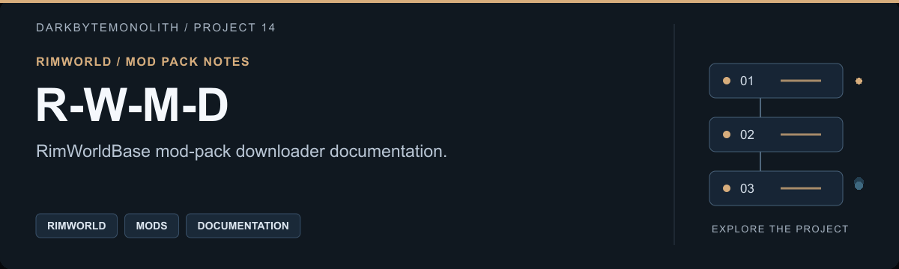
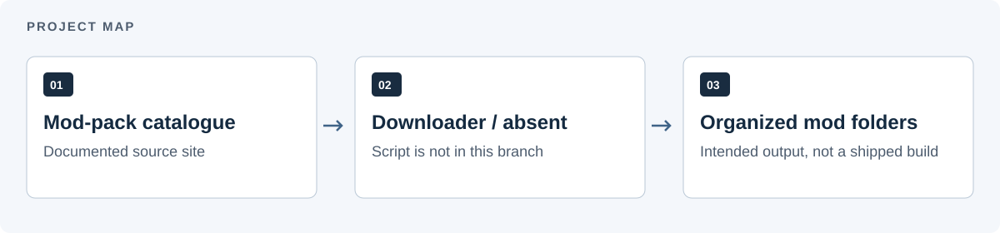

<!-- readme-design:start -->
<p align="center">
  <picture>
    <source media="(prefers-reduced-motion: reduce)" srcset="docs/readme/hero.svg" />
    
  </picture>
</p>

<p align="center">
  
  
  
</p>

<p align="center"><a href="#features">Features</a> · <a href="#requirements">Requirements</a> · <a href="#installation">Installation</a> · <a href="#usage">Usage</a> · <a href="#customization">Customization</a></p>

<table>
  <tr>
    <td width="33%" valign="top"><b>Mod packs</b><br/>RimWorldBase downloader concept.</td>
    <td width="33%" valign="top"><b>Organization</b><br/>Documented per-pack folder layout.</td>
    <td width="33%" valign="top"><b>Current branch</b><br/>Implementation script is absent.</td>
  </tr>
</table>


<!-- readme-design:end -->

> [!IMPORTANT]
> **Documentation-only branch:** `R-W-M-D.py` is not committed here. The instructions below describe the intended tool, not a runnable checkout. Obtain the implementation before following them.

A Python tool for downloading mod packs from RimWorldBase.com.

## Features

- Scans and lists available mod packs from RimWorldBase
- Downloads selected mod packs to organized folders
- User-friendly command-line interface with colorful formatting
- Handles multiple download links per mod pack
- Automatically creates a folder structure for organizing downloaded mods

## Requirements

- Python 3.6 or higher
- Required Python packages:
  - requests
  - beautifulsoup4
  - tqdm
  - colorama

## Installation

1. Clone or download this repository
2. Install required packages:


## Usage

Run the script:

```bash
python R-W-M-D.py
```

Follow the on-screen instructions to:
1. View available mod packs
2. Select a mod pack to download
3. Choose which files to download from the mod pack

The downloaded mods will be saved in a `mods` directory in the same folder as the script, organized in subfolders by mod pack name.

## Customization

You can modify the following variables in the script to customize its behavior:

- `BASE_URL`: Change the base URL if needed
- `USER_AGENT`: Modify the user agent if facing connection issues
- `downloads_folder`: Change the destination folder for downloads

## Troubleshooting

If you encounter any issues:

- Make sure you have a stable internet connection
- Check that you have the required Python version and packages installed
- Try running the script with administrator/sudo privileges if you encounter permission errors

## License

This tool is provided as-is without any warranty. Use at your own risk.

## Acknowledgements

- Thanks to RimWorldBase.com for hosting the mod packs
- Created for educational purposes only
